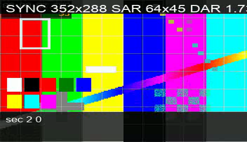

English | [中文](README.zh-CN.md)

# Fossil Frame

A self-explaining test corpus for media players: old containers, old video and
audio codecs, odd geometry, broken timing, subtitles in legacy encodings, and
files damaged the way real downloads and old discs get damaged.

Every sample is synthesized by FFmpeg from a reference signal, so the corpus
contains no third-party footage or music and can be regenerated bit-for-bit
from the scripts in this repository.



## Reading the reference signal

Each clip is a 12-second test pattern (DV clips are 6 s):

- A **white bar flashes at the top every whole second**, together with a short
  **1 kHz beep**, and the `sec N` counter changes at the same instant. If the
  beep comes early or late, A/V sync or timestamp handling is broken.
- The **white box should look square** and the grid straight. If not, SAR/DAR
  handling is wrong. The real geometry is printed on the frame.
- **Eight fixed color patches** expose wrong color matrix, range or pixel format.
- A **white marker sweeps across every 5 s**. Stutter, freezes or jumps point
  to timing or decoder problems.
- A **yellow title line** (where present) states what the file tests and what
  you should see or hear.

## Layout

| Directory | Files | What it tests | Details |
|---|---:|---|---|
| `dataset/normal/` | 50 | Old containers and codecs that must decode cleanly (AVI, ASF, RM, MOV, 3GP, FLV, VOB, Ogg, NUT; Cinepak, SVQ1, DV, HuffYUV, RV10/20, WMV1/2, MSMPEG4, ASP QPel/GMC, …) | [Catalog](docs/CATALOG.md) |
| `dataset/degraded/` | 10 | Valid files carrying analog and transcoding damage: VHS wear, chroma bleed, interlacing, telecine, A/V offset | [Degradation](docs/DEGRADATION.md) |
| `dataset/damage/` | 21 | Corrupted, truncated, headless, index-broken and half-downloaded files | [Catalog](docs/CATALOG.md#damaged-files) |
| `dataset/tracks/` | 6 | Karaoke L/R channels, dual-language DVD, 5.1 channel ID (AC-3/DTS), default-track flags | [Tracks & subtitles](docs/TRACKS_AND_SUBTITLES.md) |
| `dataset/subtitles/` | 13 | SRT in GBK/Big5/UTF-8 BOM/UTF-16, SSA, MicroDVD, VobSub, DVB, ASS with attached font | [Tracks & subtitles](docs/TRACKS_AND_SUBTITLES.md) |
| `dataset/structure/` | 30 | Missing cues/index, packed B-frames, PTS wrap, stream switches, VFR, gaps, edit lists, rotation, chapters, GBK tags, color tags, 1080i | [Structure](docs/STRUCTURE.md) |
| `dataset/mislabeled/` | 6 | Extension does not match the real format | [Structure](docs/STRUCTURE.md#mislabeled-extension-does-not-match-content) |

`dataset/manifest.csv` lists every file with container, codecs, size, SAR and fps.

## Regenerate and verify

Requires Python 3 and FFmpeg built with libx264, libxvid, libmp3lame,
libvorbis, libtheora, libvpx, libopencore-amrnb and libspeex.

```bash
python3 generate_suite.py --outdir dataset        # normal/ + damage/
python3 generate_degradation.py --outdir dataset  # degraded/
python3 generate_extra.py --outdir dataset        # everything else
./tools/verify.sh
```

See [Verification](docs/VERIFICATION.md) for the reference environment and
results, and [Source material](docs/SOURCE_MATERIAL.md) for provenance.

## Known gaps

FFmpeg has no encoders for RealVideo 3/4, Cook/SIPR, WMV3/VC-1, WMA Pro, Indeo or
QDesign, so these formats are not included. See
[Proprietary gaps](docs/PROPRIETARY_GAPS.md) for what that leaves untested
and how to add lawfully obtained samples.

## License

[MIT](LICENSE) © 2026 zydo. The bundled font `assets/fonts/PressStart2P-Regular.ttf`
is under the [SIL Open Font License 1.1](assets/fonts/OFL.txt). Reference
snapshots in `docs/references/` remain the property of their original publishers.
