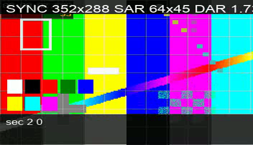

[English](README.md) | 中文

# Fossil Frame

一套自解释的播放器测试集，覆盖老容器、老视频/音频编码、异常几何、错乱时序、
老编码字幕，以及真实下载和老光盘里常见的损坏方式。

所有样本都由 FFmpeg 从参考信号合成，不包含第三方视频或音乐，可以用仓库里的
脚本完整复现。



## 怎么看参考信号

每个片段都是 12 秒测试图（DV 为 6 秒）：

- **顶部白条每个整秒闪一次**，同时有约 80 ms 的 **1 kHz 蜂鸣**，`sec N` 也在这一刻
  切换。蜂鸣提前或滞后，说明音画同步或时间戳处理有问题。
- **白色方框应显示为正方形**，网格应保持笔直；变形说明 SAR/DAR 处理错误。
  画面上印有实际几何参数。
- **八个固定色块**：偏色、灰阶丢失或对比度错误，说明色彩矩阵、范围或像素格式有误。
- **白色标记每 5 秒横穿一次**：卡顿、冻结、跳变说明时间戳或解码有问题。
- 有**黄色标题行**的文件，标题写明了测什么、应该看到/听到什么。

## 目录

| 目录 | 文件数 | 测什么 | 详细说明 |
|---|---:|---|---|
| `dataset/normal/` | 50 | 必须正常解码的老容器与老编码 | [逐文件清单](docs/CATALOG.zh-CN.md) |
| `dataset/degraded/` | 10 | 合法但带模拟/转码缺陷：VHS、色度拖尾、隔行、电视电影、音画偏移 | [退化样本](docs/DEGRADATION.zh-CN.md) |
| `dataset/damage/` | 21 | 损坏、截断、缺文件头、索引损坏、下载未完成 | [逐文件清单](docs/CATALOG.zh-CN.md#损坏文件清单) |
| `dataset/tracks/` | 6 | 卡拉 OK 左右声道、DVD 双音轨、5.1 声道识别、默认音轨 | [音轨与字幕](docs/TRACKS_AND_SUBTITLES.zh-CN.md) |
| `dataset/subtitles/` | 13 | GBK/Big5/UTF-8 BOM/UTF-16 SRT、SSA、MicroDVD、VobSub、DVB、ASS 附件字体 | [音轨与字幕](docs/TRACKS_AND_SUBTITLES.zh-CN.md) |
| `dataset/structure/` | 30 | 缺索引、packed B 帧、PTS 回绕、流切换、VFR、时间戳空洞、edit list、旋转、章节、GBK 元数据、色彩标签、1080i | [结构与元数据](docs/STRUCTURE.zh-CN.md) |
| `dataset/mislabeled/` | 6 | 扩展名与真实格式不符 | [结构与元数据](docs/STRUCTURE.zh-CN.md#mislabeled扩展名与内容不符) |

`dataset/manifest.csv` 是机器可读清单，列出每个文件的容器、编码、尺寸、SAR、帧率和字节数。

## 重新生成与验收

需要 Python 3，以及启用 libx264、libxvid、libmp3lame、libvorbis、libtheora、
libvpx、libopencore-amrnb、libspeex 的 FFmpeg。

```bash
python3 generate_suite.py --outdir dataset        # normal/ + damage/
python3 generate_degradation.py --outdir dataset  # degraded/
python3 generate_extra.py --outdir dataset        # 其余类别
./tools/verify.sh
```

生成环境与验收结果见 [验收记录](docs/VERIFICATION.zh-CN.md)，素材来源见
[素材来源](docs/SOURCE_MATERIAL.zh-CN.md)。

## 已知边界

FFmpeg 没有 RealVideo 3/4、Cook/SIPR、WMV3/VC-1、WMA Pro、Indeo、QDesign 的编码器，
因此这些格式不在本集中。缺口和补充方法见 [专有格式缺口](docs/PROPRIETARY_GAPS.zh-CN.md)。

## 许可证

[MIT](LICENSE) © 2026 zydo。附带字体 `assets/fonts/PressStart2P-Regular.ttf` 采用
[SIL Open Font License 1.1](assets/fonts/OFL.txt)。`docs/references/` 中的参考资料快照
版权归原发布方所有。
