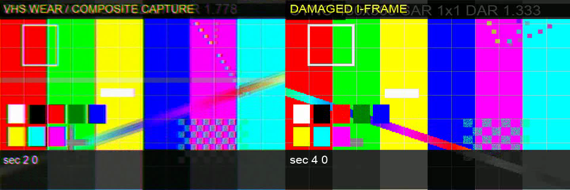

English | [中文](DEGRADATION.zh-CN.md)

# Degraded samples from old distribution chains

[← Back to README](../README.md)

Files in `dataset/degraded/` are valid media files that deliberately carry the
visible defects left by decades of copying, re-encoding, downloading, truncation,
bad discs and poor capture. They differ from `dataset/damage/`: `damage/` tests
recovery from structural damage, while `degraded/` tests whether a player
displays bad picture quality, old timing, interlacing and A/V offset stably.

## Where the defects come from

Common sources, confirmed by web research, fall into four layers:

1. **Analog/tape sources**: VHS color-under has very narrow chroma bandwidth, which
   smears chroma; dropouts leave white/black horizontal streaks; tracking errors
   produce bands, tearing and vertical jumps; timebase errors end up in the
   captured file. See VHS restoration articles and preservation-lab notes on
   tracking, dropout and TBC.
2. **Generation loss**: both analog copying and digital lossy transcoding
   accumulate loss. Blocking, ringing and chroma subsampling from the first
   encode are treated as real content by the next one, which blurs edges and
   adds banding and mosquito noise.
3. **Damage in predictive video codecs**: MPEG/MPEG-4/RealVideo/DivX/Xvid predict
   from I/P/B frames. When a keyframe or reference frame is damaged, the error
   carries into later P/B frames in the GOP: seconds of mosaic, ghost outlines,
   or a freeze followed by slow recovery. EBU's MPEG primer and compression
   artifact references describe macroblock prediction and blocking.
4. **Container/timing/distribution problems**: AVI files with missing indexes or
   damaged chunks are common; DivX/Xvid packed B-frames are a classic AVI
   compatibility trap; VBR MP3 in AVI tends to drift; MKV relies on cues; MPEG-TS
   relies on PCR/PTS/continuity; bad sectors on VCD/DVD make players skip.

## The ten samples

| File | Simulated defect | What to look for |
|---|---|---|
| `vhs_composite_wear_mpeg2_ac3_720x480.mkv` | Composite noise, chroma shift, smear, dropout streaks, tracking band | Noise and smear are shown but audio is unaffected; the dirty picture must not hang the player |
| `chroma_under_bleed_mpeg2_ac3_720x480.mkv` | VHS color-under horizontal chroma smear | Red/blue outlines offset or soft; checks color conversion and upsampling |
| `motion_ghost_trails_mpeg4_mp3_480x360.mp4` | Inter-frame trails, double outlines, motion ghosting | The moving marker leaves several outlines; check that the renderer adds no extra blending/blur |
| `generation_loss_x3_mpeg4_mp3_352x240.avi` | Three generations of low-bitrate lossy transcoding | Blocking, ringing, banding, smeared detail; must not crash |
| `long_gop_bitstream_errors_mpeg4_mp3_480x360.avi` | Long GOP, low-quality prediction | Error propagation inside the GOP and recovery after seeking |
| `damaged_i_frame_mpeg4_mp3_480x360.avi` | 96 bytes of the second I-frame overwritten | Specks/ghosts/mosaic spreading from the damaged keyframe; check recovery at the next I-frame |
| `interlaced_wrong_handling_mpeg2_ac3_720x480.mkv` | 59.94 fields woven into 29.97 interlaced frames | Wrong progressive display shows combing; correct field order is clean |
| `telecine_judder_mpeg2_mp3_720x480.mpg` | 23.976 → 29.97 repeated-field cadence | Whether cadence is detected; wrong IVTC causes judder |
| `vbr_mp3_audio_offset_mpeg4_352x240.avi` | AVI + VBR MP3 + 350 ms audio offset | Audio should lag by a steady ~0.35 s for the whole clip, without getting worse |
| `dropped_duplicated_frames_mpeg4_mp3_480x360.mkv` | Capture drops with renumbered timestamps | The marker skips; the player must not turn skips into stalls |

`long_gop_bitstream_errors...` is produced with FFmpeg's encoder error rate and a
long GOP; current decoders may silently conceal it and do not always report
errors. `damaged_i_frame...` is the more deterministic keyframe-damage sample.

## References

- AVI damage in distribution:
  [VirtualDub, AVI files and common problems](https://www.virtualdub.org/blog2/entry_025.html) | [Snapshot](references/virtualdub-avi-common-problems.md)
- VHS tracking lines, dropout, TBC:
  [EachMoment preservation lab](https://www.eachmoment.co.uk/blog/vhs-tracking-lines-static-and-dropout-what-a-lab-fixes-before-it-transfers) | [Snapshot](references/eachmoment-vhs-tracking-dropout.md)
- Generation loss:
  [Generation loss](https://en.wikipedia.org/wiki/Generation_loss) | [Snapshot](references/wikipedia-generation-loss.md)
- MPEG prediction, I/P/B, macroblock concealment:
  [EBU Technical Review: MPEG video coding](https://tech.ebu.ch/docs/techreview/trev_266-ely.pdf) | [Snapshot](references/ebu-trev-266-mpeg-video-coding.md)
- DivX/Xvid packed B-frames:
  [Avidemux wiki: B-frames](https://www.avidemux.org/admWiki/doku.php?id=using%3Ab-frames) | [Snapshot](references/avidemux-wiki-b-frames.md)
- Historic VBR MP3 / AVI sync fixes in old tools:
  [VirtualDub version history](https://www.videohelp.com/software/Virtualdub/version-history) | [Snapshot](references/videohelp-virtualdub-version-history.md)
- Matroska cues / clusters / error recovery:
  [RFC 9559](https://www.rfc-editor.org/info/rfc9559) | [Snapshot](references/rfc9559-matroska.md)
- MPEG-TS PCR/PTS/continuity:
  [PCR in MPEG-TS](https://www.forasoft.com/learn/audio-for-video/articles-audio/pcr-mpeg-ts-program-clock-reference) | [Snapshot](references/forasoft-pcr-mpeg-ts.md)
- Bad-disc reads and skipping:
  [MakeMKV forum discussion](https://forum.makemkv.com/forum/viewtopic.php?t=16629) | [Snapshot](references/makemkv-forum-t16629.md)
- Interlacing / telecine / combing / ghosting QC terms:
  [UMG Content Guide](https://contentguide.universalmusic.com/qc-terminology-guide) | [Snapshot](references/umg-qc-terminology-guide.md)
