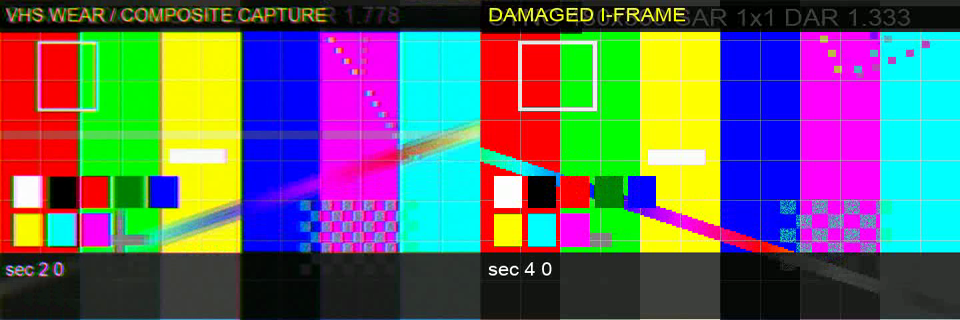

[English](DEGRADATION.md) | 中文

# 老传播路径退化样本

[← 返回 README](../README.zh-CN.md)

`dataset/degraded/` 里的文件是合法媒体文件，但故意带有“几十年复制、压制、
下载、截断、坏碟、劣质采集”留下的可见缺陷。它们与 `dataset/damage/` 不同：
`damage/` 测试结构损坏后的恢复，`degraded/` 测试播放器对坏画质、旧时序、
隔行和音画偏移的稳定显示。

## 故障来源

联网检索确认的常见来源可以分成四层：

1. **模拟/磁带源**：VHS 的 color-under 色度带宽很窄，会造成色度拖尾；掉磁产生
   横向白/黑断线；跟踪误差产生横带、撕裂和垂直跳动；时基误差会进入采集文件。
   参见 VHS restoration/active-list articles 和 preservation lab 对 tracking、
   dropout、TBC 的说明。
2. **代际损失**：模拟复制和数字有损转码都会累积损失。第一次编码产生的马赛克、
   振铃、色度欠采样会被下一次编码当作“真实内容”，导致轮廓糊化、色带和
   mosquito noise。
3. **预测型视频编码损坏**：MPEG/MPEG-4/RealVideo/DivX/Xvid 使用 I/P/B 帧预测。
   关键帧或参考帧损坏时，误差会延续到 GOP 内后续 P/B 帧，出现数秒马赛克、
   轮廓鬼影或冻结后缓慢恢复。EBU 的 MPEG 介绍和 compression artifact 资料都
   描述了 macroblock 预测与 blocking artifact。
4. **容器/时序/传播链问题**：AVI 缺索引、chunk 损坏很常见；DivX/Xvid packed
   B-frames 是老 AVI 兼容性陷阱；VBR MP3 in AVI 容易漂移；MKV 依赖 cues；
   MPEG-TS 依赖 PCR/PTS/continuity；VCD/DVD 的坏扇区会导致播放器跳段。

## 生成的十类样本

| 文件 | 模拟缺陷 | 看什么 |
|---|---|---|
| `vhs_composite_wear_mpeg2_ac3_720x480.mkv` | 复合视频噪声、色度偏移、拖影、掉磁横线、跟踪带 | 噪声和拖尾应显示但不影响音频；播放器不得因脏画面卡死 |
| `chroma_under_bleed_mpeg2_ac3_720x480.mkv` | VHS color-under 色度横向拖尾 | 红蓝轮廓错位/发糊；检查色彩转换和上采样 |
| `motion_ghost_trails_mpeg4_mp3_480x360.mp4` | 帧间拖尾、双轮廓、运动残影 | 移动标记会留下多个轮廓；判断 renderer 是否额外叠加/模糊 |
| `generation_loss_x3_mpeg4_mp3_352x240.avi` | 三代低码率有损转码 | 方块、振铃、色带、细节糊化；不应崩溃 |
| `long_gop_bitstream_errors_mpeg4_mp3_480x360.avi` | 长 GOP、低质量预测结构 | 观察 GOP 内错误传播和 seek 后恢复 |
| `damaged_i_frame_mpeg4_mp3_480x360.avi` | 第二个 I 帧的 96 字节被改写 | 关键帧损坏后的花点/鬼影/马赛克扩散；看能否等下一个 I 帧恢复 |
| `interlaced_wrong_handling_mpeg2_ac3_720x480.mkv` | 59.94 场源合成为 29.97 隔行帧 | 错误 progressive 播放会有横向梳齿；正确 field order 处理应清晰 |
| `telecine_judder_mpeg2_mp3_720x480.mpg` | 23.976 转 29.97 的重复帧节奏 | 观察是否识别 cadence、错误 IVTC 是否造成抖动 |
| `vbr_mp3_audio_offset_mpeg4_352x240.avi` | AVI + VBR MP3 + 350 ms 音频偏移 | 整段音画应稳定落后约 0.35 s，不应越播越乱 |
| `dropped_duplicated_frames_mpeg4_mp3_480x360.mkv` | 采集丢帧后重排时间戳 | 移动标记会跳步；播放器不得把跳步放大成停顿 |

`long_gop_bitstream_errors...` 用 FFmpeg 的 encoder error-rate 和长 GOP 生成；
当前解码器可能静默纠正，不一定每次都显式报错。`damaged_i_frame...` 是更确定
的关键帧损坏复刻。

## 参考线索

- AVI 传播损坏：
  [VirtualDub, AVI files and common problems](https://www.virtualdub.org/blog2/entry_025.html) | [快照](references/virtualdub-avi-common-problems.md)
- VHS 跟踪线、dropout、TBC：
  [EachMoment preservation lab](https://www.eachmoment.co.uk/blog/vhs-tracking-lines-static-and-dropout-what-a-lab-fixes-before-it-transfers) | [快照](references/eachmoment-vhs-tracking-dropout.md)
- 代际损失：
  [Generation loss](https://en.wikipedia.org/wiki/Generation_loss) | [快照](references/wikipedia-generation-loss.md)
- MPEG 预测、I/P/B、macroblock concealment：
  [EBU Technical Review: MPEG video coding](https://tech.ebu.ch/docs/techreview/trev_266-ely.pdf) | [快照](references/ebu-trev-266-mpeg-video-coding.md)
- DivX/Xvid packed B-frames：
  [Avidemux wiki: B-frames](https://www.avidemux.org/admWiki/doku.php?id=using%3Ab-frames) | [快照](references/avidemux-wiki-b-frames.md)
- 老工具对 VBR MP3 / AVI sync 的修正记录：
  [VirtualDub version history](https://www.videohelp.com/software/Virtualdub/version-history) | [快照](references/videohelp-virtualdub-version-history.md)
- Matroska cues / cluster / error recovery：
  [RFC 9559](https://www.rfc-editor.org/info/rfc9559) | [快照](references/rfc9559-matroska.md)
- MPEG-TS PCR/PTS/continuity：
  [PCR in MPEG-TS](https://www.forasoft.com/learn/audio-for-video/articles-audio/pcr-mpeg-ts-program-clock-reference) | [快照](references/forasoft-pcr-mpeg-ts.md)
- 坏盘读取/跳段行为：
  [MakeMKV forum discussion](https://forum.makemkv.com/forum/viewtopic.php?t=16629) | [快照](references/makemkv-forum-t16629.md)
- Interlacing / telecine / combing / ghosting QC terms：
  [UMG Content Guide](https://contentguide.universalmusic.com/qc-terminology-guide) | [快照](references/umg-qc-terminology-guide.md)
